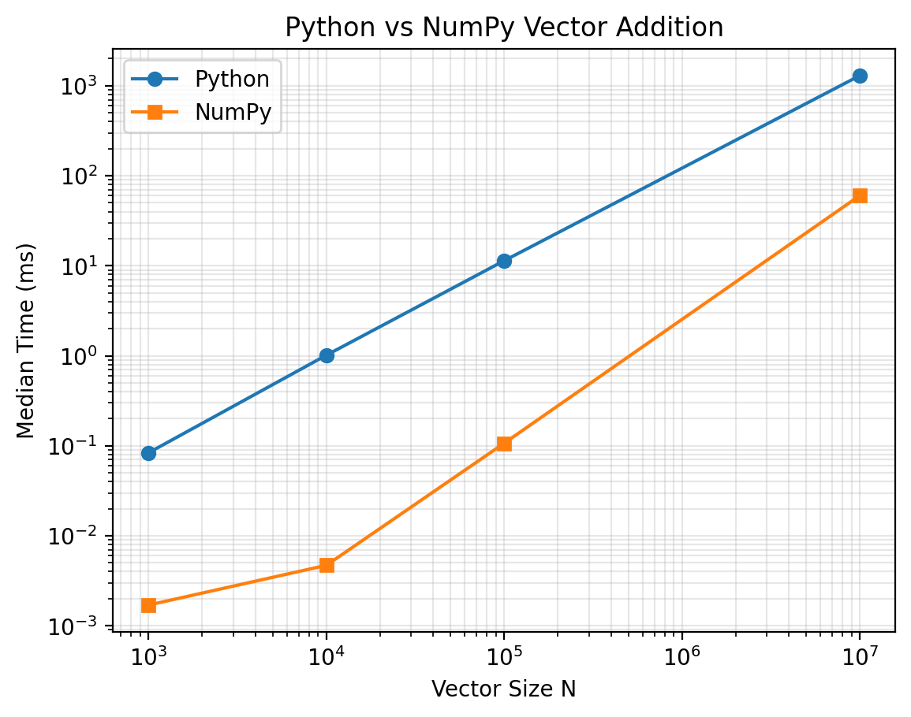

# Week 02 — Python 与 NumPy 向量加法性能实验总结

> 学习单元：W02 · Python / NumPy Benchmark  
> 数据来源：本目录下 `raw.csv`（已核对）与 `median_time.png`。  
> 状态：核心性能实验与可视化已完成；环境信息、输入初始化独立计时和正确性运行证据仍需补充。

## 1. 实验目标

对相同的逐元素向量加法 `c[i] = a[i] + b[i]`，比较原生 Python `for` 循环和 NumPy `a + b` 的性能；在不同规模下统计 Median、P95、加速比，并估算逻辑数据流量与有效带宽。观察输入规模变化对性能的影响，区分测量结果与尚未证实的瓶颈解释。

## 2. 实验环境与配置

| 条目 | 记录 |
|---|---|
| 操作系统 | Windows 路径环境（依据执行脚本路径；具体版本待填写） |
| CPU 型号 / 核心数 | **待填写** |
| 物理内存容量 | **待填写** |
| Python 版本 | **待填写** |
| NumPy 版本 | **待填写** |
| Git commit | **待填写** |
| 输入规模 | `1,000`、`10,000`（额外）、`100,000`、`10,000,000` |
| NumPy 输入 dtype | `float64`，每元素 8 字节 |
| 预热次数 | 5 次（此前提交的计时代码配置；CSV 不记录预热样本） |
| 正式测量次数 | 每种实现、每种规模 30 次（已由 CSV 验证） |
| 计时器 | `time.perf_counter_ns()` |
| 分位数口径 | `numpy.percentile(samples, 95)`，默认线性插值 |

## 3. 实现和测量边界

- **Python 版**：预先准备输入列表，函数内创建结果列表，使用 `for` 对每个索引进行加法，并返回新列表。
- **NumPy 版**：将输入预先转换为 `np.asarray(..., dtype=np.float64)`，计时函数执行 `a + b` 并返回新数组。
- **计时包含**：被测加法函数本身，包括函数内结果容器或结果数组的分配，以及必要的元素读写。
- **计时不包含**：测试数据构造、Python 列表转 NumPy 数组，以及调用外部统计/绘图代码。
- **初始化耗时**：目前 `raw.csv` 只记录计算函数耗时，没有初始化时间单独的采样结果，因此不能据此比较端到端耗时。
- **正确性**：此前的实验设计以 `np.allclose` 检查两版数值一致；当前提交的 CSV 无正确性测试字段，也未附对应运行日志。正式复现时需要单独运行并留存结果。由于数值计算可能存在精度差异，验证需明确输入类型与容差口径。

## 4. 原始数据完整性

- `raw.csv` 列名：`n, implementation, repeat, elapsed_ns, input_bytes`。
- 总计 **240 条**有效记录 = 4 档规模 × 2 种实现 × 30 次。
- 各组 `repeat` 均完整覆盖 **1–30**、无重复，`elapsed_ns` 均为正数。
- `input_bytes` 对各规模都等于 `16 × N` 字节，即**两个 float64 NumPy 输入数组的逻辑字节数**。该字段不是 Python 列表实际内存占用，也没有包含输出数组。

## 5. 实验结果

以下统计由上传的 `raw.csv` 重新计算；时间单位均为毫秒（ms），带宽为十进制 GB/s（1 GB = 10⁹ bytes）。

| N | Python Median (ms) | Python P95 (ms) | NumPy Median (ms) | NumPy P95 (ms) | Speedup | NumPy 有效带宽 (GB/s) |
|---:|---:|---:|---:|---:|---:|---:|
| 1,000 | 0.08355 | 0.18933 | 0.00170 | 0.00195 | 49.15× | 14.12 |
| 10,000 | 1.01445 | 1.12429 | 0.00470 | 0.00485 | 215.84× | 51.06 |
| 100,000 | 11.37575 | 12.47832 | 0.10680 | 0.21399 | 106.51× | 22.47 |
| 10,000,000 | 1296.07300 | 1338.01291 | 60.23815 | 68.37737 | 21.52× | 3.98 |

**定义**：`Speedup = Python Median / NumPy Median`。P95 是对该组 30 次计时独立计算出的 95 百分位，**不是**中位数的百分比。

### 5.1 性能曲线



横轴为输入向量长度 `N`，纵轴为 `Median Time (ms)`，双轴均使用对数刻度。图中已包括正式要求的 `N=10³、10⁵、10⁷`，也保留 `N=10⁴` 的补充数据。

### 5.2 逻辑数据量与有效带宽

对于 `float64` 向量加法 `c = a + b`，理论上每个元素需要读取两个输入（2 × 8 B），写出一个结果（1 × 8 B），因此：

```text
输入字节数        = 2 × N × 8 = 16N bytes
输出字节数        = 1 × N × 8 =  8N bytes
逻辑总数据流量    = 3 × N × 8 = 24N bytes
NumPy 有效带宽   = (24N bytes) / (NumPy Median seconds) / 10^9 GB/s
```

| N | 输入 (MB) | 输出 (MB) | 逻辑总流量 (MB) |
|---:|---:|---:|---:|
| 1,000 | 0.016 | 0.008 | 0.024 |
| 10,000 | 0.160 | 0.080 | 0.240 |
| 100,000 | 1.600 | 0.800 | 2.400 |
| 10,000,000 | 160.000 | 80.000 | 240.000 |

在 `N=10,000,000` 时，逻辑流量为 **240 MB**，NumPy 中位耗时 **60.23815 ms**，得到有效带宽 **约 3.98 GB/s**。

这里的“有效带宽”是用**逻辑读写字节数 / 函数耗时**计算的指标；它不是硬件计数器测得的 DRAM 实际传输量，也没有扣除数组分配及其他函数开销。小规模数据可能命中缓存，因此这些数字不可直接拿来代表物理内存带宽。

## 6. 结果分析

### 6.1 为什么 NumPy 明显快于 Python 循环？

两种实现从渐进复杂度看都需要遍历 N 个元素，即 **O(N)**，但运行时常数不同。Python 循环包含逐元素解释器执行、索引访问及 Python 对象操作；NumPy 可在底层编译代码中连续处理数值数组，并可能利用更高效的指令和数据访问方式。数据支持 NumPy 在本次四档规模下均快于 Python，但没有直接证明具体使用了哪种 SIMD 指令。

### 6.2 为什么加速比先上升后下降？

本次加速比约为 **49.15× → 215.84× → 106.51× → 21.52×**。小规模下固定函数开销和计时噪声占比更高；更大规模下，缓存层次、内存访问、数组结果分配和系统负载等可能改变耗时占比。**目前无法凭这一条曲线认定 N=10⁷ 已经受 DRAM 带宽限制。**

要区分这些解释，需要补充 CPU/内存配置、不同轮次与不同输入规模的重复实验，并结合硬件性能计数器或 profiler 观察缓存未命中、实际带宽、内存分配开销等；也可比较预分配输出和每次新建输出的版本。

### 6.3 数据范围与局限

1. 仅针对一种运算（向量加法）、`float64` 数组以及四档输入规模，不能推广到所有 NumPy 运算。
2. `raw.csv` 保存了原始计时，但未包含 CPU 型号、系统负载、频率策略、内存占用和采样日期，跨机器或跨日期对比需谨慎。
3. 初始化/格式转换未单独计时，不能宣称测得了包含输入构造的端到端性能；按计划此项仍需补充。
4. `input_bytes` 记录的是 NumPy 输入的逻辑存储量；Python `list` 以及 Python 浮点对象的实际占用可能明显更大。
5. 尚未提供独立的 `np.allclose` 测试日志，以及其他 dtype 的实测结果；这些部分不应写成已验证事实。

## 7. 复现与文件结构

```text
week2/
├── src/
│   ├── vector_bench.py     # 实际路径与入口请核对
│   └── test.py             # 已用于读取 CSV 和绘图
└── results/
    ├── raw.csv             # 240 条计时记录
    ├── median_time.png     # 性能图
    └── summary.md          # 本报告
```

在 AIinfra 项目根目录运行绘图脚本（根据此前提交的 `test.py` 结构）：

```powershell
python week2/src/test.py
```

环境信息可用下列命令补全：

```powershell
python --version
python -c "import numpy as np; print(np.__version__)"
git rev-parse --short HEAD
```

**待补复现证据**：原始 Benchmark 的确切运行命令（以实际程序入口为准）；包含 `np.allclose` 的正确性测试输出；输入初始化的独立计时；CPU、内存和操作系统版本。不要把绘图命令误认为重新生成 `raw.csv` 的完整命令。

## 8. Week 02 刷题与 C++ 面试训练记录

- **LC242 有效的字母异位词（必做）**：完成计数数组版本，6 组断言测试输出 `LC242: All tests passed!`；计数逻辑 O(N) 时间、O(1) 固定计数数组空间。当前按值传参会带来额外字符串复制开销，分析整个函数空间时需计入。
- **LC283 移动零（选做）**：完成 `read` / `write` 双指针原地覆盖，5 组样例输出符合预期；O(N) 时间、O(1) 算法额外空间。单独测试程序中的数组复制不属于被测算法本身。
- **面试知识点**：指针可重新指向对象，引用初始化后不能重新绑定；返回局部变量引用可能产生悬空引用与未定义行为；RAII 利用对象生命周期及析构管理资源，异常栈展开时自动清理已构造的局部 RAII 对象。
- **本周面试模块**：必做 LC242、选做 LC283 与指针/引用/生命周期/RAII 问答已完成本轮练习。后续可进行不看答案重写与口述复盘，不等同于已验证长期掌握。

## 9. 最终结论与待办

1. 核心性能结果明确：在本次数据中，NumPy 对四档输入规模均优于 Python 原生循环；最大样本 N=10⁷ 的中位耗时分别为 60.23815 ms（NumPy）与 1296.07300 ms（Python），加速比约 21.52×。
2. 四档 × 两种实现 × 30 次的 CSV 原始数据与双对数性能图齐备；`input_bytes` 记录口径一致。
3. 正式关闭 W02 前，建议补齐 **环境版本、初始化独立计时、正确性测试日志、原始数据重跑命令**，并保留一次 Git 提交以支持复现。
